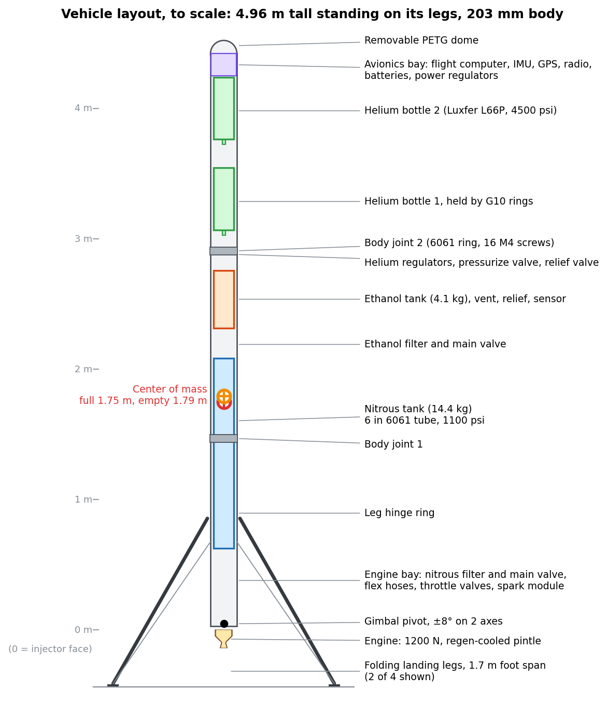
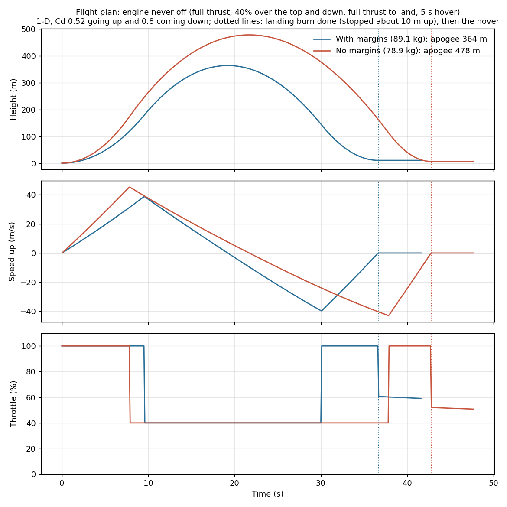
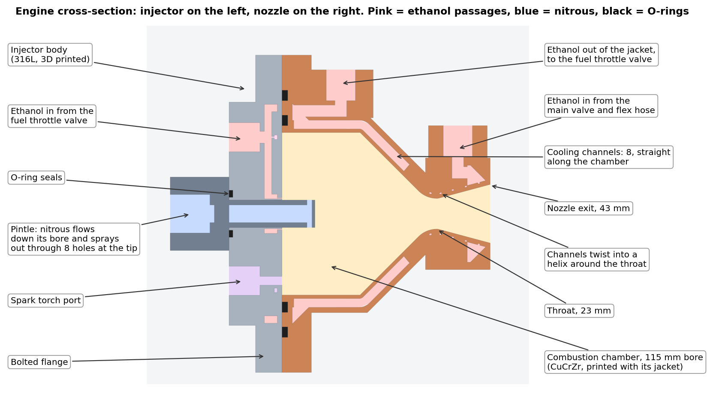
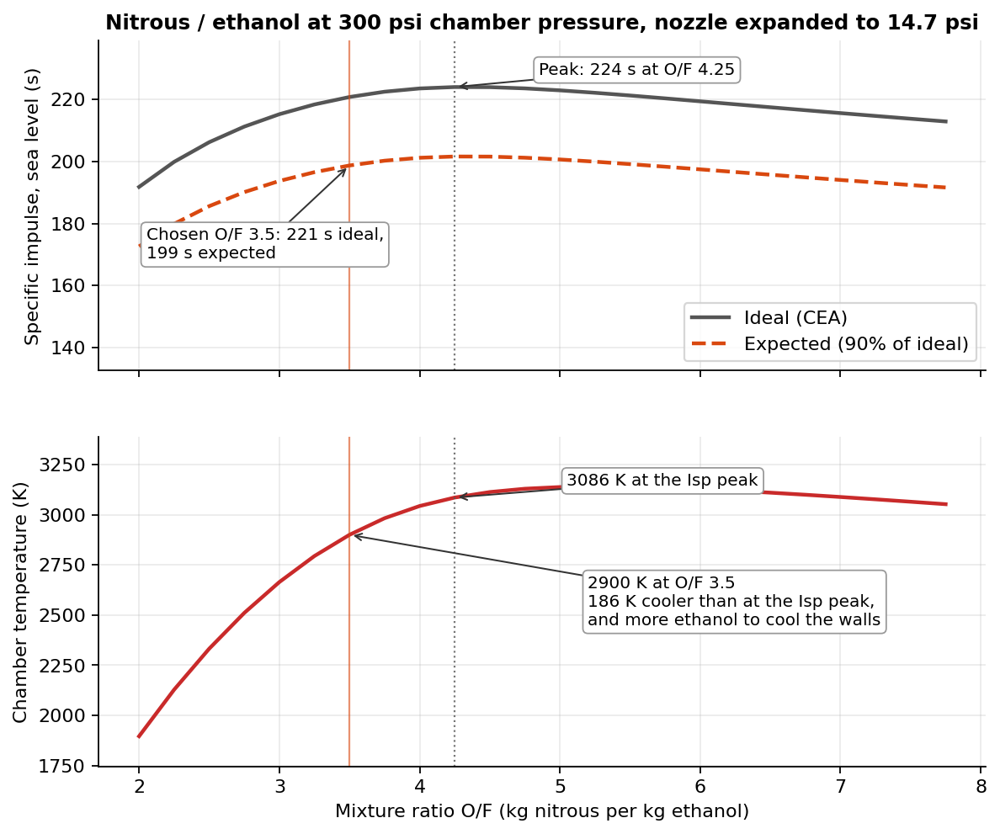
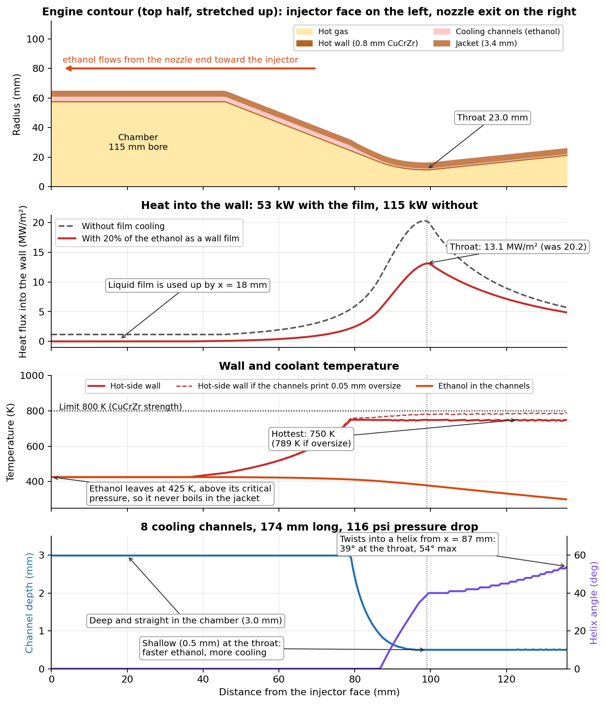
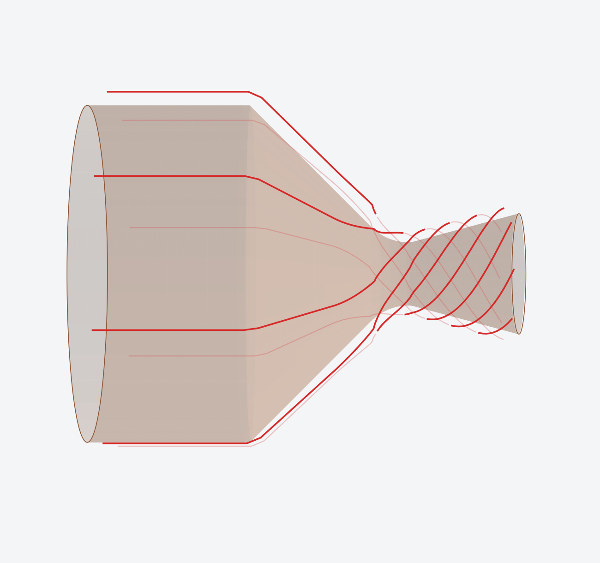
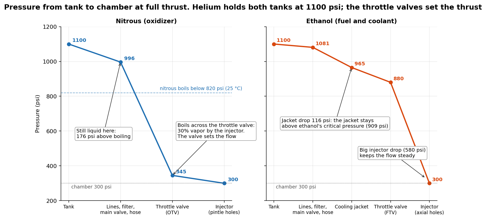
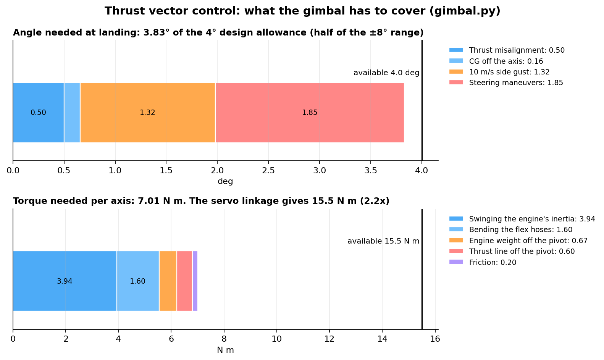
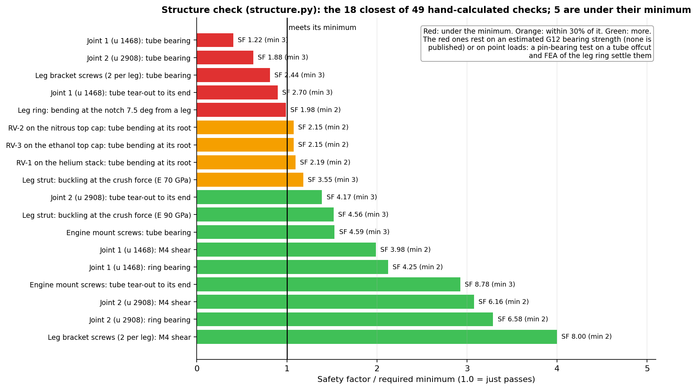
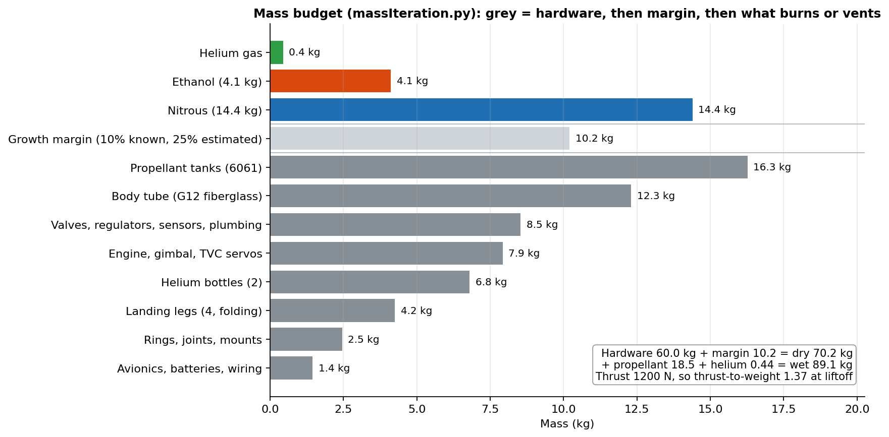

# VTVL-TVC

A liquid-fueled rocket that takes off and lands vertically (VTVL). It steers with a gimbaled engine (thrust vector control, TVC). The engine burns nitrous oxide and ethanol, is throttled by two servo-driven needle valves, is cooled by its own fuel, and is fed by helium pressure.

This repo holds the design code (Python), the full SolidWorks model and the OpenRocket model. **It is a design study: nothing has been built or fired yet.**

| | |
|---|---|
| Thrust | 1200 N at full throttle, throttles down to 40% |
| Height | 4.66 m from the nozzle exit to the top of the dome, 203 mm (8 in) body |
| Mass | 89.1 kg at liftoff with growth margins, 70.6 kg empty |
| Thrust-to-weight | 1.37 at liftoff |
| Propellant | 18.5 kg: 14.4 kg nitrous, 4.1 kg ethanol (O/F 3.5) |
| Pressurant | Helium, 2 bottles at 4500 psi, holding both tanks at 1100 psi |
| Engine | Regeneratively cooled pintle engine, 300 psi chamber, 199 s Isp expected |
| Steering | 2-axis gimbal, ±8°, two servos |
| Landing | 4 folding legs with crush cartridges, 1.7 m foot span |
| Flight | About 365 m up and back down to a 5 s hover, all with the engine lit |

## Contents

- [How it flies](#how-it-flies)
- [The engine](#the-engine)
- [Feed system](#feed-system)
- [Thrust vector control](#thrust-vector-control)
- [Structure and landing legs](#structure-and-landing-legs)
- [Avionics](#avionics)
- [Mass budget](#mass-budget)
- [The design code](#the-design-code)
- [The CAD](#the-cad)
- [Work In Progress](#work-in-progress)

## How it flies

The engine never shuts off between liftoff and landing:

1. **Climb** at full thrust.
2. **Coast over the top and fall** at 40% throttle. The engine stays lit so the gimbal can keep the rocket pointed up.
3. **Landing burn** at full thrust, timed to stop about 10 m above the ground.
4. **Hover** for 5 s and set down. 10% of the propellant is held in reserve.

An earlier plan shut the engine off after the climb and relit it for landing. `attitude_check.py` showed that doesn't work: a bare rocket body is aerodynamically unstable falling tail-first, and even a 0.1° lean at cutoff grows to 13-31° by the relight. Keeping the engine lit lets the gimbal steer the whole way.

*Height, speed and throttle for the whole flight (`flight_plot.py`), with the full growth margins (blue) and without (red). With drag, OpenRocket (`openrocket_sim.py`) gets 367 m with margins and 482 m without. OpenRocket only models the climb, because it can't steer a powered descent.*

## The engine

### Propellants and operating point

`cea_analysis.py` runs NASA CEA for nitrous and ethanol over a range of mixture ratios:

- **Mixture ratio 3.5** is fuel-rich of the 4.25 Isp peak. That gives up about 3 s of Isp for a chamber 186 K cooler and more ethanol to cool the walls.
- **Chamber pressure 300 psi.** This was lowered from 640 psi, where regenerative cooling couldn't keep the throat wall under its limit.
- **Expected Isp 199 s** (90% of the 221 s ideal), so full thrust takes 616 g/s: 479 g/s nitrous and 137 g/s ethanol.
- **Geometry:** 115 mm chamber bore, 23.0 mm throat, 42.6 mm exit (area ratio 3.4, ideal for sea level). Contraction ratio 25, L* 1.62 m, 45° converging and 15° diverging cones, 136 mm from the injector face to the exit.

### Pintle injector (`injector.py`, `injector_hardware.py`, `two_phase.py`)

- **Nitrous** flows down the bore of a 19.2 mm pintle and sprays outward through 8 radial holes near its tip.
- **Ethanol** comes in through 8 axial holes in a ring around the pintle's base. Each nitrous jet hits an ethanol stream, which is where they mix.
- **Momentum ratio** is 2.49, nitrous to ethanol.
- **Pressure drops:** 46 psi across the nitrous holes and 580 psi across the ethanol holes.
- **Two-phase flow:** nitrous starts to boil as soon as its pressure drops, so its flow through every hole and valve uses the Dyer two-phase model in `two_phase.py`.
- **Film cooling:** 20% of the ethanol is split off to 8 film-cooling holes that spray a liquid film onto the chamber wall.
- **Build:** the injector body is 3D printed in 316L stainless, with its small holes and sealing faces drilled and machined after printing. The pintle is machined 316.

### Cooling (`heat_transfer.py`, `chamber_hardware.py`)

The chamber and nozzle are printed as one piece in CuCrZr copper alloy (laser powder bed fusion), with the liner, cooling channels and outer jacket together. All of the ethanol flows through the jacket before it reaches the injector. It enters near the nozzle exit and flows toward the injector, so it is still cold when it reaches the throat, where the wall is hottest.

- **Heat flux** comes from the Bartz correlation using CEA's gas properties. The film cuts the throat heat flux from 20.2 to 13.1 MW/m², and the total heat into the wall from 115 to 53 kW.
- **Channels:** 8 of them, 2 mm wide under a 0.8 mm hot wall. They're 3 mm deep and straight along the chamber. Toward the throat they get shallower (0.5 mm) to speed the ethanol up, and they twist into a helix (up to 54°) so the channel stays long enough to pick up the heat.
- **Hottest wall** is 750 K against an 800 K limit. Even if the channels print 0.05 mm oversize, the wall stays under the limit, at 789 K.
- **No boiling in the jacket:** the jacket runs at about 1000 psi, above ethanol's critical pressure (909 psi), so the coolant can't boil. It leaves at 425 K after a 116 psi drop.

*Cooling channel paths (red): straight along the chamber, twisting into a helix through the throat and nozzle.*

`rejected_cooling_checks.py` keeps the options that were tried and dropped: an annular-gap jacket, where the coolant was too slow, and a copper heat-sink throat, which overheats within seconds.

### Ignition

A spark torch sits on the injector's igniter port. It uses an NGK CM-6 plug and a CH Ignitions CDI module, and it is fed nitrous and ethanol tapped from the engine's own lines, so there are no separate torch valves. The start sequence:

1. Open the main valves with both throttles closed.
2. Crack the fuel throttle.
3. Spark.
4. The chamber pressure sensor (PT-8) confirms the torch is lit.
5. Open the nitrous throttle.

## Feed system

Helium pushes both propellants out of their tanks. Each propellant then passes through a filter, a servo-driven ball valve, a flex hose (so the engine can gimbal) and a servo-driven needle valve that sets the thrust. The ethanol also goes through the cooling jacket before its throttle valve, so the jacket stays near tank pressure at every throttle setting. `feed_system.py` sizes every line, valve, filter and hose.

- **Helium:** two Luxfer ECLIPSE PRO L66P carbon bottles at 4500 psi, two regulators that hold the tanks at 1100 psi, a pressurize valve, check valves, a burst disc and a relief valve.
- **Tanks:** 6061-T6 tube, 6 in OD with a 0.188 in wall. The nitrous tank is 1.39 m long and the ethanol tank 0.37 m. Each end is a flat 20 mm 6061 cap held by 24 radial screws. Each tank has a servo-driven vent valve, a 1250 psi relief valve and a pressure sensor.
- **Nitrous stays liquid** up to the throttle valve: 176 psi above its boiling pressure at 25 °C. It then flashes across the valve, which chokes the flow, so the valve alone sets the nitrous flow and chamber pressure can't push back on it.
- **Main valves:** Swagelok 43G-series ball valves turned by servos. **Throttle valves:** Swagelok SS-1VS8 (nitrous) and SS-1VS6 (ethanol) vee-stem needle valves, each turned by a goBILDA 5-turn servo through a 1:1 gear pair.

The throttle valves need this range (`feed_system.py`):

| Thrust | Nitrous valve Cv | Ethanol valve Cv | Nitrous vapor at the injector |
|---|---|---|---|
| 100% | 0.466 | 0.295 | 30% |
| 73% (hover at liftoff) | 0.322 | 0.089 | 36% |
| 57% (hover at landing) | 0.248 | 0.060 | 39% |
| 40% (minimum) | 0.170 | 0.042 | 43% |

## Thrust vector control

The engine hangs from a 2-axis gimbal ring and swings up to ±8° in each axis. Two Savox SB-2290SG servos at 7.4 V drive it through ball-link pushrods with a 3.17:1 lever ratio. `gimbal.py` works out how far and how hard the gimbal must move to hold the rocket upright through a 10 m/s side gust, thrust misalignment, an off-axis center of mass and steering maneuvers.

- **Angle:** the worst case is landing, when the rocket is light and the center of mass is closest to the gimbal. It needs 3.83° against a 4° design allowance (half the mechanical range, kept as margin).
- **Torque and speed:** the gimbal needs 7.0 N m and 126°/s (a 4° swing at 5 Hz). The linkage gives 15.5 N m and 145°/s.
- **Moving mass:** 8.1 kg swings with the engine, including the throttle valves, their servos and the igniter.
- **Roll** isn't controlled: a single gimbaled engine can't do it.

## Structure and landing legs

- **Body:** Wildman G12 filament-wound fiberglass tube, 8 in, in three lengths joined by 6061 rings with 16 M4 screws each.
- **Inside the body:** the tanks are held by 6061 rings screwed through the tube wall, the helium bottles sit between G10 rings with rubber liners, and the lines are held by rubber blocks and cushion clips.
- **Top:** a removable PETG dome covers the avionics bay.
- **Legs:** four umbrella-style folding legs. Each has a 30 × 27 mm carbon strut with a crushable honeycomb cartridge (1.25 kN, about 4.2 g at touchdown) and steel cables. One servo releases all four. They're sized for a 2 m/s touchdown.

`structure.py` checks every part that carries load with hand formulas, at liftoff, at full gimbal tilt in a gust, at landing (all four legs, and one leg touching first) and during handling. The minimum safety factors are 2 on yield for metal, 3 on ultimate for G12, G10 and PETG, and 2 on proof or breaking strength for screws and cables.

- **5 of 49 checks are under their minimum.** Four of them rest on the fiberglass tube's bearing strength, which Wildman doesn't publish. A pin-bearing test on an offcut will settle those, and FEA of the leg ring settles the fifth.
- **Bending:** the body's first bending mode is about 11-17 Hz, only 2-3x the 5 Hz gimbal bandwidth. This will matter for the control loop.

## Avionics

The bay at the top holds the flight computer (IMU, barometer, GPS), an RFD900x radio with two dipole antennas, the batteries, the power regulators and the arming switches. There are 10 servos in all:

- 2 for the gimbal
- 5 for the valves (pressurize, two vents and two main valves)
- 2 for the throttles
- 1 for the leg release

They run off a 3S 2200 mAh battery through two Castle BECs: 7.4 V for the gimbal servos and 6.6 V for the valve servos, which max out at 6.8 V. The spark module and the 7.4 V BEC sit low in the engine bay, near what they power.

## Mass budget

`massIteration.py` adds up the hardware list (`parts_list.csv`) and the engine and gimbal masses from the CAD. It puts a 10% growth margin on masses that are known (catalog parts, CAD) and 25% on estimates. Then it sizes the propellant for the required delta-v.

- **Tanks are frozen** at an 86.2 kg sizing mass, so the CAD doesn't change every time a part's mass is updated. Adding mass now lowers the thrust-to-weight and the apogee instead of growing the tanks.
- **Limit:** the 1200 N engine reaches the 1.3 minimum thrust-to-weight at about 94 kg.
- **Check against the CAD:** the summed CAD masses come to 87.7 kg with margins, close to the budget's 89.1 kg.

## The design code

Every script reads its inputs from `design_values.json` and writes its results back there, so one file always holds the current design. Values with `"source": "input"` are the design choices; everything else is a result, tagged with the script that calculates it. `design.py` does the reading and writing.

The design is calculated in this order (`run_all.py` runs the first 10 steps):

| Script | What it does |
|---|---|
| `cea_analysis.py` | Combustion (NASA CEA): Isp, c*, chamber temperature and gas properties; sizes the chamber and nozzle |
| `massIteration.py` | Mass budget and propellant mass; sizes the tanks and the helium bottles |
| `cea_analysis.py` | Second pass with the final thrust |
| `heat_transfer.py` | Bartz heat flux, film cooling, regen channel depth and twist, wall temperatures, jacket wall; writes the chamber curves in `CAD/curves` |
| `chamber_hardware.py` | Chamber flange, bolts, O-rings and coolant manifolds |
| `injector.py` | Pintle injector holes and pressure drops (two-phase nitrous) |
| `injector_hardware.py` | Injector body passages, ports, seals, walls and bolts |
| `feed_system.py` | Lines, filters, valves, hoses, throttle range, helium regulator and relief, tank end caps |
| `vehicle_layout.py` | Stacks the sections and finds the height, center of mass and pitch inertia, full and empty |
| `gimbal.py` | Gimbal angle, torque, speed, servo linkage, clearances and strength |
| `plumbing_layout.py` | Real stack heights from the real plumbing parts |
| `structure.py` | Structure check (safety factors for every load path) |
| `flight_plan.py` | The flight plan, shared by the flight scripts |
| `attitude_check.py` | Rocket lean between engine cutoff and relight (why the engine stays lit) |
| `openrocket_sim.py` | Builds the OpenRocket model, runs the climb and saves the `.ork` files in `sim/` |
| `flight_plot.py` | The whole-flight graph, `sim/flight_profile.png` |
| `two_phase.py` | Dyer two-phase flow model (used by `injector.py` and `feed_system.py`) |
| `rejected_cooling_checks.py` | Cooling options that were checked and rejected |

**Requirements:** Python 3 with numpy, scipy, matplotlib, CoolProp and NASA CEA's Python package (`import cea`). `openrocket_sim.py` also needs OpenRocket 24.12 and JPype (`pip install jpype1`).

**Not runnable from this repo alone:** `structure.py`, `attitude_check.py`, `flight_plot.py` and `openrocket_sim.py` need layout data that isn't in this repo.

## The CAD

SolidWorks 2026 files (they won't open in older versions). Heights in the model are measured in mm above the injector face.

| File | What it is |
|---|---|
| `CAD/Rocket.SLDASM` | The whole rocket: 813 parts, 1852 mates, fully defined, no collisions with the legs open or folded and the engine at full tilt |
| `CAD/Engine.SLDASM` | Engine: chamber, injector body, pintle, bolts and O-rings (24 parts) |
| `CAD/Engine_Gimbal.SLDASM` | Engine on its gimbal with servos and linkages (90 parts) |
| `CAD/*.SLDPRT` | Engine and gimbal parts |
| `CAD/plumbing/` | Tanks, valves, regulators, fittings, tubes and hoses |
| `CAD/hardware/` | Body tube, screws, nuts, O-rings, pins, servos |
| `CAD/legs/` | Landing legs |
| `CAD/throttle/` | Throttle valve servos, gears and brackets |
| `CAD/torch/` | Spark torch and chamber pressure sensor line |
| `CAD/mounts/` | Bottle rings, line blocks and clips |
| `CAD/avionics/` | Avionics bay, dome, body joint rings, batteries, boards, antennas |
| `CAD/curves/` | Chamber contour and channel curves from `heat_transfer.py` |

`Rocket.SLDASM` is saved with the legs open. To fold a leg, set its `Leg Open <clock>` mate to 94.52° (open is 119.78°).

## Work In Progress

---

Claude Opus 5.5 helped write the code comments and this README, and helped debug the code.
